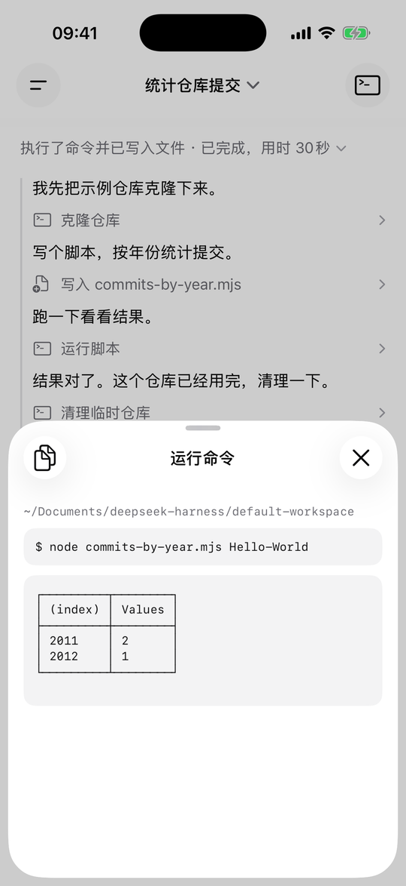
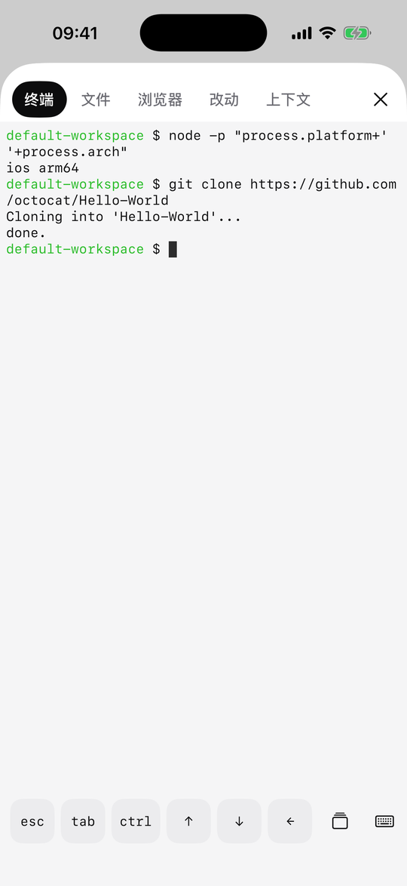
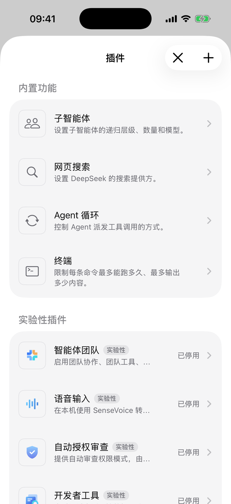
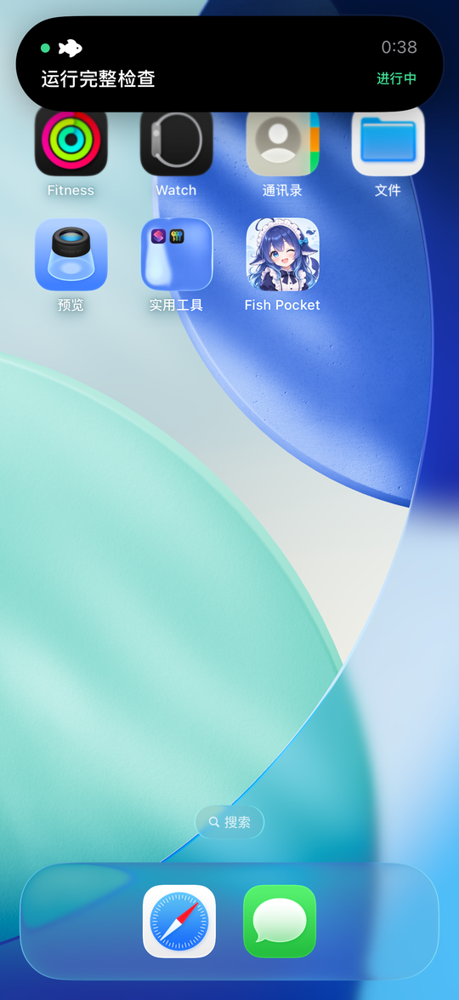
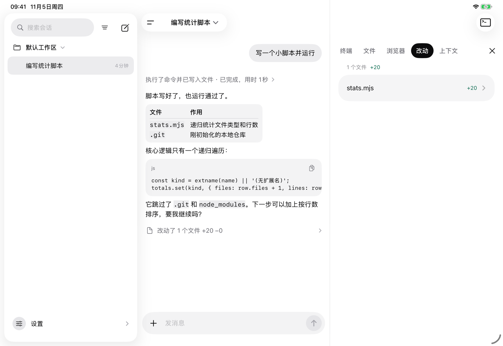
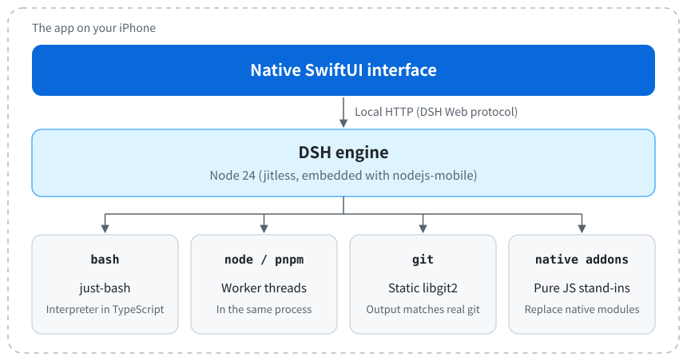

<p align="center">
  
</p>

<h3 align="center">Fish Pocket</h3>

<h1 align="center">DeepSeek Harness running on your iPhone and iPad, with a fully native interface</h1>

<p align="center">
  <b>No computer. No server. Not a web wrapper. The engine runs inside the app, and every screen is rebuilt in SwiftUI.</b>
</p>

<p align="center">Want an agent in your pocket too? <a href="https://testflight.apple.com/join/2SCftb2M"><b>Join the TestFlight beta</b></a>, and a ⭐ helps.</p>

<p align="center"><a href="README.md">中文</a></p>

https://github.com/user-attachments/assets/618e690f-3873-4f08-811d-3213b3b9a056

## iOS

<p align="center">
  
  
  
  
</p>

## iPad

<p align="center">
  
</p>

## What it does

- **A fully native interface.** Chat, approvals, the workbench, plugins and settings are all rebuilt in SwiftUI and designed for iOS, not a web page in a WebView. Dark mode is supported: follow the system, or pick light or dark in Settings. The official Web UI is still there in Settings if you want it.
- **A complete agent.** Chat, tool calls, file editing, search, plan mode and approvals, matching the official Web UI's features.
- **A terminal that works.** Built-in bash, `node`, `pnpm` and `git`, plus `rg`, `jq`, `curl`, `sed`, `awk` and other everyday commands.
- **Built-in Git.** Statically linked libgit2, no child processes. `clone`, `commit`, `branch`, `merge`, `stash`, `pull`, `push` and the rest of everyday git work, with output that matches real git so the agent reads it as usual. Private repositories authenticate over HTTPS with a token.
- **The DSH plugin ecosystem.** Install pure JavaScript plugins from npm and enable them on the phone.
- **A workbench.** Terminal, file preview, built-in browser and change review in one panel.
- **Made for iOS.** Dynamic Island and Lock Screen Live Activities, and tasks that continue in the background.
- **Made for iPad too.** A persistent sidebar, a side workbench, multiple windows, file drag and drop, and keyboard shortcuts.
- **More private.** Sessions and workspaces stay on your device.

Model calls still need a network connection. Use a DeepSeek account or an API key.

## Compared with other approaches

|  | Fish Pocket | Remote clients | Web UI on the phone | Linux emulators on iOS (iSH, UTM SE) |
|---|---|---|---|---|
| Where the engine runs | Phone | Computer or server | Phone | Phone |
| Interface | Fully native SwiftUI | Depends on the project | Official Web UI | Terminal or official Web UI |
| Computer must stay on | No | Yes | No | No |
| Dynamic Island and Lock Screen status | Yes | Depends on the project | Depends on the project | No |
| Full Linux tools | No, only built-in commands and Node | Yes | Depends on the project | Yes |
| Speed | Node runs natively, several times slower than a desktop | Native speed on the computer | Depends on the project | Very slow: CPU instructions are interpreted one by one |

## Quick start

To install it, open the [TestFlight beta link](https://testflight.apple.com/join/2SCftb2M) on your iPhone or iPad. It needs iOS 17 or later.

To build it yourself, you need macOS, Xcode 26, Node 24 and `xcodegen`, plus `cmake` or `uv` to build libgit2.

```bash
git clone https://github.com/imsai-sh/fish-pocket.git
```

```bash
cd fish-pocket && scripts/run-sim.sh
```

The script downloads nodejs-mobile, builds libgit2, assembles the engine, then installs and runs the app on a simulator. The default device is `iPhone 17 Pro`; set `SIM_DEVICE` to choose another.

To run on a device, replace `com.wsw.dsh-ios` in `app/project.yml` and `scripts/run-device.sh` with your own bundle ID, then run:

```bash
DEVELOPMENT_TEAM=<your team id> scripts/run-device.sh
```

## How it works

iOS does not let apps create child processes or run downloaded binaries. Instead of emulating a Linux machine, this project embeds Node in the app and swaps DSH's "execution world" through the engine's own service seams. Not a single engine file is modified.

<p align="center">
  <picture>
    <source media="(prefers-color-scheme: dark)" srcset="docs/assets/architecture-en-dark.svg">
    
  </picture>
</p>

## Roadmap

- [ ] Better third-party plugin support
- [ ] Move the bash interpreter off the engine thread

## Contributing

Issues and PRs are welcome. Have your agent read [CONTRIBUTING.md](CONTRIBUTING.md).

## Credits

**Special thanks to [DSH Go](https://github.com/ccch1mneyyy/dsh-go)**, which inspired us to build this iOS version.

Fish Pocket also stands on the shoulders of these projects.

**Used directly:**

- [DeepSeek Harness](https://github.com/deepseek-ai/deepseek-harness): the engine, and the reason any of this exists
- [nodejs-mobile](https://github.com/nodejs-mobile/nodejs-mobile) and its [digidem fork](https://github.com/digidem/nodejs-mobile): Node 24 on iOS
- [just-bash](https://github.com/vercel-labs/just-bash): a bash interpreter written in TypeScript
- [libgit2](https://github.com/libgit2/libgit2): git inside the app
- [SwiftTerm](https://github.com/migueldeicaza/SwiftTerm): the terminal view

**Ideas we learned from:**

- [dsh-mobile](https://github.com/saya-ch/dsh-mobile): remote access for DSH
- [a-Shell](https://github.com/holzschu/a-shell): proof that iOS can have a genuinely useful local terminal

Thanks also to the DSH community, whose fan works gave us the "big fat fish" nickname. The whale girl mascot comes from the original character by [上善无形](https://space.bilibili.com/4456176) and the maid redesign by [ZipZipPipe](https://www.pixiv.net/artworks/148186519). Third-party licenses are in [THIRD_PARTY_NOTICES.md](THIRD_PARTY_NOTICES.md).

## Author

Built by [sai](https://imsai.cc). More at [imsai.cc](https://imsai.cc).

Other open source projects:

- [awesome-deepseek-harness-plugins](https://github.com/imsai-sh/awesome-deepseek-harness-plugins): a DSH plugin store and directory with 11,000+ plugins ([deepseek1024.com](https://deepseek1024.com/))
- [zhuzhiliao](https://github.com/imsai-sh/zhuzhiliao): a web simulation of a traditional Chinese spinning noise toy

## License

The code is [MIT](LICENSE).

The mascot images (app icon, launch image and README header) are not covered by MIT. They are based on other people's work and used under [CC BY-NC-SA 4.0](https://creativecommons.org/licenses/by-nc-sa/4.0/), so **commercial use is not allowed**. If you use this code commercially, replace those images first. See [THIRD_PARTY_NOTICES.md](THIRD_PARTY_NOTICES.md).

---

> This is an independent community project. It is not affiliated with, authorized by, or endorsed by DeepSeek. The name nods to "big fat fish" (大肥鱼), a community nickname for DeepSeek. The mascot is based on the community's fan-made whale girl, with a new expression generated by AI. The original character's copyright belongs to its creators, 上善无形 and ZipZipPipe. It does not use the DeepSeek logo.
